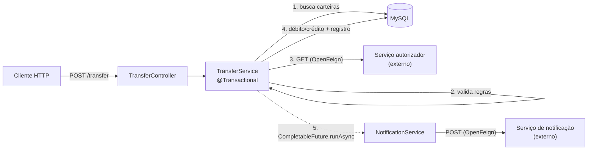

# desafio-picpay

Implementação do [desafio back-end do PicPay](https://github.com/PicPay/picpay-desafio-backend): uma API de transferências entre carteiras. Usuários comuns enviam dinheiro para outros usuários e para lojistas, e lojistas apenas recebem. Antes de cada transferência um serviço externo de autorização é consultado via **OpenFeign**, e o recebedor é notificado de forma **assíncrona**, sem afetar a resposta da API.

## Arquitetura



Fluxo de `POST /transfer`:

1. Busca as carteiras do pagador (`payer`) e do recebedor (`payee`). Se alguma não existir, retorna `422`.
2. Valida as regras de negócio:
   - só carteiras do tipo `USER` podem enviar; carteiras `MERCHANT` apenas recebem;
   - o saldo do pagador precisa cobrir o valor;
   - o serviço autorizador externo precisa responder `{"authorized": true}`.
3. Debita o pagador, credita o recebedor e registra a transferência, tudo na mesma transação (`@Transactional`).
4. Dispara a notificação em background (`CompletableFuture.runAsync`). Uma falha na notificação é registrada no log e não desfaz a transferência.

Os erros seguem o padrão **RFC 7807 (Problem Details)**, centralizados em um `@RestControllerAdvice`.

## Tecnologias

- Java 21
- Spring Boot 3.3 (Web, Data JPA, Validation)
- Spring Cloud OpenFeign
- MySQL
- springdoc-openapi (Swagger UI)
- Lombok
- Docker Compose

## Como rodar localmente

Pré-requisitos: Java 21 e Docker. Não é preciso instalar o Maven: o projeto usa o Maven Wrapper.

```bash
# 1. Suba o MySQL (banco picpaydb, usuário admin / senha 123)
docker compose -f docker/docker-compose.yml up -d

# 2. Rode a aplicação (no Windows, use mvnw.cmd)
./mvnw spring-boot:run
```

A aplicação sobe em `http://localhost:8080`. As tabelas são criadas pelo Hibernate (`ddl-auto=update`), e os tipos de carteira (`USER` e `MERCHANT`) são inseridos na inicialização pelo `DataLoader`.

### Serviços externos (autorizador e notificação)

As URLs dos mocks ficam em `application.properties` (`client.authorization.service.url` e `client.notification.service.url`). Os mocks originais do run.mocky.io **não estão mais no ar**, então aponte essas propriedades para outro mock antes de testar transferências. O autorizador precisa responder a um `GET` com:

```json
{ "authorized": true }
```

As propriedades podem ser sobrescritas sem editar o arquivo:

```bash
./mvnw spring-boot:run -Dspring-boot.run.arguments="--client.authorization.service.url=http://localhost:8099/authorize --client.notification.service.url=http://localhost:8099/notify"
```

### Saldo inicial

Toda carteira nasce com saldo `0`, e a API não tem endpoint de depósito. Para testar uma transferência, defina um saldo direto no banco:

```bash
docker compose -f docker/docker-compose.yml exec mysql \
  mysql -uadmin -p123 picpaydb -e "UPDATE tb_wallet SET balance = 100.00 WHERE id = 1;"
```

## Documentação da API (Swagger)

- Swagger UI: http://localhost:8080/swagger-ui.html
- OpenAPI (JSON): http://localhost:8080/v3/api-docs

## Endpoints

### `POST /wallets`: cria uma carteira

`walletType` aceita `USER` ou `MERCHANT`. CPF/CNPJ e e-mail são únicos.

```bash
curl -X POST http://localhost:8080/wallets \
  -H "Content-Type: application/json" \
  -d '{
    "fullName": "Maria Silva",
    "cpfCnpj": "12345678900",
    "email": "maria@email.com",
    "password": "123456",
    "walletType": "USER"
  }'
```

Resposta `200 OK`:

```json
{
  "id": 1,
  "fullName": "Maria Silva",
  "cpfCnpj": "12345678900",
  "email": "maria@email.com",
  "password": "123456",
  "balance": 0,
  "walletType": { "id": 1, "description": "user" },
  "transferAllowedForWalletType": true
}
```

CPF/CNPJ ou e-mail já cadastrado, `422 Unprocessable Entity`:

```json
{
  "type": "about:blank",
  "title": "Wallet Data Already Exists",
  "status": 422,
  "detail": "CpfCnpj or Email already exists",
  "instance": "/wallets"
}
```

### `POST /transfer`: transfere entre carteiras

```bash
curl -X POST http://localhost:8080/transfer \
  -H "Content-Type: application/json" \
  -d '{ "value": 50.00, "payer": 1, "payee": 2 }'
```

Resposta `200 OK`: a transferência registrada. `sender` e `receiver` trazem as carteiras completas, no mesmo formato da resposta de `POST /wallets` (omitidas aqui):

```json
{
  "id": "f8d9a800-3bee-492e-a446-a209b3372818",
  "sender": { "...": "..." },
  "receiver": { "...": "..." },
  "value": 50.00
}
```

Respostas de erro:

| Situação | Status | `title` |
|---|---|---|
| Carteira inexistente | `422` | `Wallet not found` |
| Pagador é lojista (`MERCHANT`) | `422` | `This wallet type is not allowed for this transaction` |
| Saldo insuficiente | `422` | `Insufficient Balance` |
| Autorizador negou | `422` | `Transfer not authorized.` |
| Corpo inválido | `400` | `Seus paramêtros não são válidos.` |

Exemplo de corpo inválido (`{"value": 0, "payer": 1}`):

```json
{
  "type": "about:blank",
  "title": "Seus paramêtros não são válidos.",
  "status": 400,
  "instance": "/transfer",
  "invalidParams": [
    { "name": "payee", "reason": "não deve ser nulo" },
    { "name": "value", "reason": "deve ser maior que ou igual a 0.01" }
  ]
}
```

## Estrutura do projeto

```
src/main/java/br/com/munhosdev/picpay
├── client/       # Clientes OpenFeign (autorizador e notificação)
├── config/       # DataLoader com os tipos de carteira
├── controller/   # WalletController e TranferController, com DTOs validados
├── entity/       # Wallet, WalletType e Transfer (JPA)
├── exception/    # Exceções de negócio → Problem Details (RFC 7807)
├── repository/   # Repositórios Spring Data JPA
└── service/      # Regras de transferência, autorização e notificação
```
